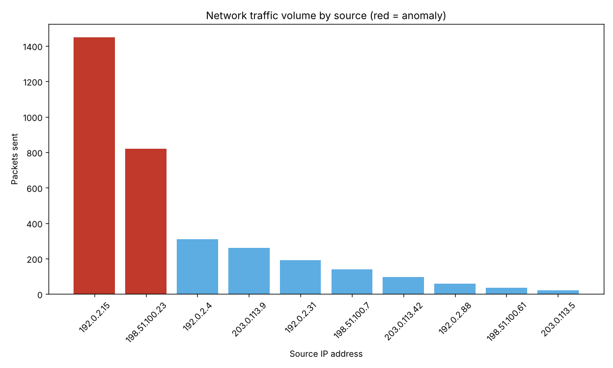

# Mini Projects

[](https://github.com/wardelias/mini-projects/actions/workflows/ci.yml)


Small, self-contained Python tools, each with its own README and tests.

| Project | What it does | Stack |
|---|---|---|
| [network-traffic-anomaly](network-traffic-anomaly) | Parses a packet capture, counts traffic per source host, flags hosts above a threshold and charts the top talkers | scapy · matplotlib · argparse |
| [ai-funnel-builder](ai-funnel-builder) | Interactive CLI for building marketing funnels, computing stage drop-off and getting optimisation advice from Claude | Anthropic API |

<p align="center"></p>

## Run the tests

```bash
pip install -r requirements.txt pytest
python -m pytest -q
```

Tests run offline: the traffic tests write a synthetic capture, and the funnel tests never
call the API.

## License

[MIT](LICENSE)
