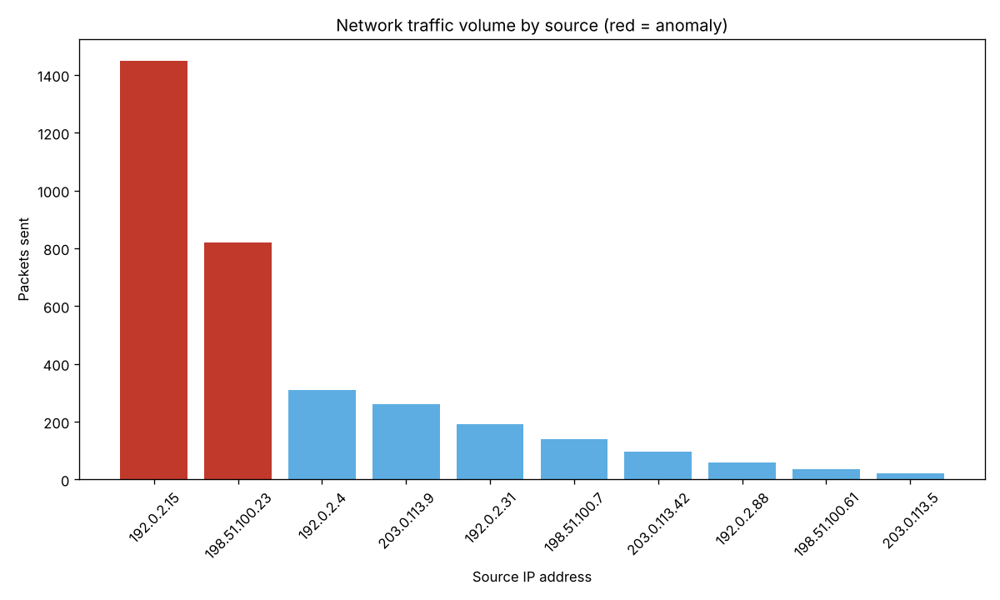

# Network Traffic Anomaly Detector

Finds unusually chatty hosts in a packet capture. It counts IPv4 packets per source
address, flags every source above a threshold, and plots the top talkers with anomalies in
red.



## Usage

```bash
pip install scapy matplotlib
python traffic_anomaly.py capture.pcapng --threshold 500 --top 10 --out chart.png
```

| Option | Default | Meaning |
|---|---|---|
| `--threshold` | 500 | packets above which a source is flagged |
| `--top` | 10 | number of sources to plot |
| `--out` | `anomaly_graph.png` | chart file |
| `--show` | off | also open the chart window |

## Example output

```
--- TRAFFIC ANALYSIS REPORT ---
IPv4 packets analysed: 3388
Distinct sources:      11

Sources above 500 packets:
  [ALERT] 192.0.2.15 sent 1450 packets
  [ALERT] 198.51.100.23 sent 820 packets

Chart saved to chart.png
```

The example uses a synthetic capture with addresses from the documentation ranges
(RFC 5737).

## How it works

1. `rdpcap` loads the capture; packets without an IPv4 layer (ARP, IPv6) are skipped.
2. `count_sources` builds a `Counter` of source addresses.
3. `find_anomalies` keeps sources above the threshold.
4. `plot_top_talkers` draws the `most_common(top)` sources.

A fixed threshold is the simplest volume detector. Natural extensions are per-window rates,
a z-score against each host's own baseline, and flagging by destination-port fan-out to
catch scans.
